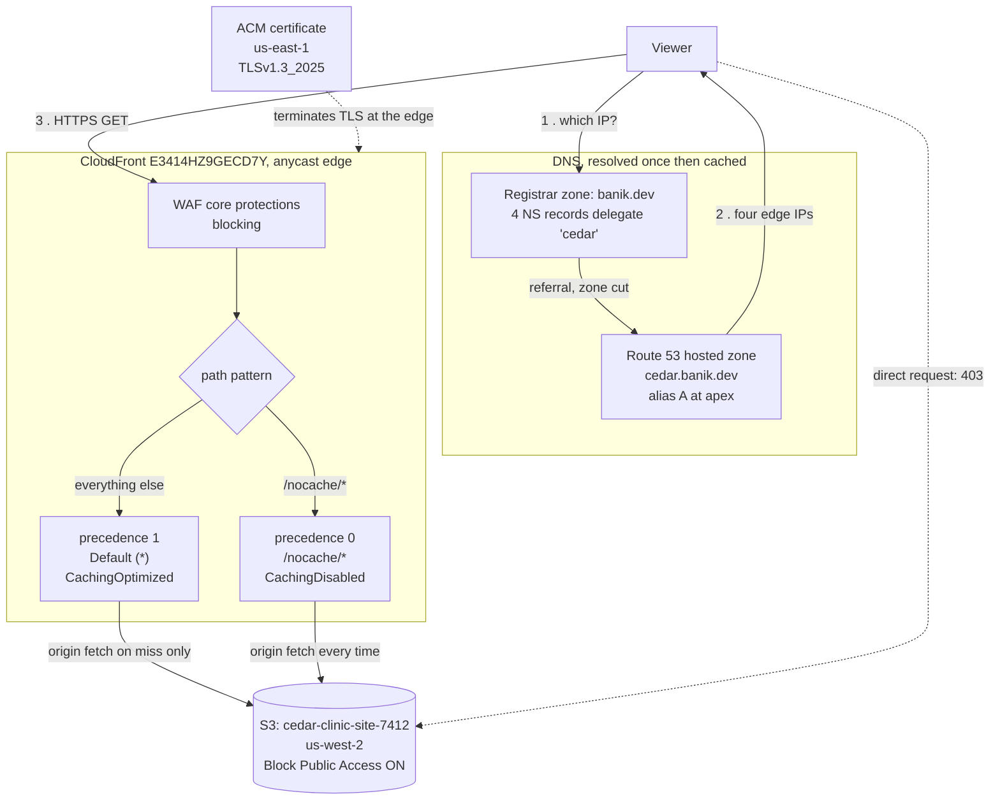

# S1 · Edge and static delivery

**Status:** Built and measured, 27 October 2026. Still standing at time of writing.
**Domains:** Design High-Performing Architectures (24%), Design Cost-Optimized Architectures (20%)

## The whole thing in plain words

The site is five files: three pages, a stylesheet and a logo. They sit in one
folder in Oregon.

Without a CDN, every visitor's browser asks Oregon for each file. Someone in
Paris waits for the Atlantic crossing, five times over.

CloudFront keeps copies of those five files on servers all over the world. The
Paris visitor is served from a server near Paris. The folder in Oregon never
moves and never changes.

Four other pieces make that work:

| Service | What it does for `cedar.banik.dev` |
|---|---|
| S3 | Holds the five files, in Oregon |
| CloudFront | Keeps copies on servers near visitors |
| Route 53 | Tells a browser which server to ask |
| ACM | The certificate proving the site is really yours |
| WAF | Checks requests before they are served |

The Oregon folder is locked so that only CloudFront can read it. Anyone asking
it directly is refused, which is the `403` that appears throughout this
document. That matters because an unlocked folder can be read straight past
CloudFront, which costs more, skips the cache and skips the filter.

### The experiment, in the same plain words

A second copy of the same five files was put in the same folder, under a prefix
called `/nocache/`. CloudFront was told it may keep a copy of the first set and
may **not** keep a copy of the second.

Same visitor, same server, same files, same encryption. The only difference is
whether the nearby server is allowed to hold a copy, or has to ask Oregon every
single time.

- Allowed to hold a copy: **69 ms**
- Has to ask Oregon: **171 ms**

That 100 ms gap is the trip to Oregon and back. It is roughly two-thirds of the
total wait, for a file of 2,479 bytes.

## What it proves

Caching removes the origin round trip, and the origin round trip is almost the
entire cost of a small request. Measured here at **2.4x on time to first byte**,
reproduced across three runs.

The second half of the original claim, that CDN egress costs less per GB than
origin egress, is **not proved here.** See "What is not built".

## What got built

| Resource | Detail |
|---|---|
| S3 bucket | `cedar-clinic-site-7412`, us-west-2, Block Public Access on, SSE-S3, 10 objects |
| CloudFront | `E3414HZ9GECD7Y`, `d37aucrxis75gt.cloudfront.net`, Free plan |
| Origin access | Origin Access Control, bucket policy written by the console wizard |
| Certificate | ACM in us-east-1, DNS validated, auto-renewing |
| DNS | Route 53 public hosted zone `cedar.banik.dev`, delegated from the registrar with four NS records |
| Record | Alias A at the zone apex, pointing at the distribution |
| Firewall | WAF core protections, monitor mode first, then blocking |

Two cache behaviours, which is what makes the measurement possible:

```
precedence 0   /nocache/*    Managed-CachingDisabled
precedence 1   Default (*)   Managed-CachingOptimized
```

Both serve the same five files from the same bucket. Same bytes, same edge, same
TLS session, compression off on both. The only variable is whether CloudFront is
allowed to keep a copy.

## How it fits together



Reading the diagram:

- **Route 53 is consulted once, then nothing passes through it.** It answers a
  question and leaves. Traffic goes viewer to edge to origin, never through DNS.
  This is why DNS cannot be a bottleneck, and also why DNS failover is bounded
  by TTL while an in-path failover is not.
- **Both arrows into S3 are signed with Origin Access Control.** The bucket
  policy allows the CloudFront service principal and nobody else, which is what
  makes the dotted arrow a 403.
- **The two behaviours are the experiment.** Identical files, identical edge,
  identical TLS session. The only difference is whether the edge is permitted to
  keep a copy, which is what isolates caching from everything else.
- **The certificate is in us-east-1 while the bucket is in us-west-2.** Not a
  mistake. CloudFront reads certificates only from us-east-1.

## Results

### Time to first byte, cached against uncached

Five requests per run, first discarded as connection setup, median of the
remaining four. Three runs, the third after WAF was switched from monitor mode
to blocking.

| Run | cached | uncached | ratio |
|---|---|---|---|
| Distribution still `InProgress` | 68 ms | 168 ms | 2.5x |
| `Deployed` | 69 ms | 171 ms | 2.5x |
| WAF blocking | 72 ms | 173 ms | 2.4x |

Verified through `x-cache` headers rather than inferred, with identical
`content-length` on both paths and no `content-encoding` on either:

```
cached:   x-cache: Hit from cloudfront    age: 42052   content-length: 2479
nocache:  x-cache: Miss from cloudfront                content-length: 2479
```

### Consistency: a claim this project had to withdraw

Raw samples from the `Deployed` run, connection setup discarded:

```
cached    0.0659  0.0678  0.0703  0.0710            spread   5 ms
uncached  0.1514  0.1599  0.1826  0.3442            spread 193 ms
```

That looked like a second finding, and a better one than the median: a cache hit
is not only faster but far more predictable, because it never waits on the
origin.

Running `verify.sh` an hour later did not reproduce it:

```
cached    0.0629  0.0699  0.0716  0.0741  0.1603    spread  97 ms
uncached  0.1157  0.1559  0.1816  0.1885  0.2467    spread 131 ms
```

97 ms against 131 ms is not that story. One cached sample came back at 160 ms,
as slow as a typical origin fetch.

**The predictability claim is withdrawn.** It was generalised from four samples
in one run, which cannot establish a distribution, and the next run contradicted
it. The mechanism is plausible, since a cache hit has fewer things that can go
slowly, but plausible is not measured.

Doing it properly needs hundreds of samples and a percentile, p95 or p99 rather
than a spread, over a window long enough to catch the origin having a bad
moment. That is a different measurement from the one this project set out to
take, and it is not taken here.

What survives both runs is the median, at 2.4x to 2.5x every time.

Captured output from the run that contradicted the claim is in
`results/verify-2026-10-27.txt`.

### Where the time actually goes

Phase breakdown of a single warm cached request:

| Phase | Cumulative | This step |
|---|---|---|
| DNS lookup | 2.3 ms | 2.3 ms |
| TCP connect | 20.6 ms | 18.3 ms |
| TLS handshake | 45.3 ms | 24.7 ms |
| First byte | 65.3 ms | 20.0 ms |
| Last byte | 65.4 ms | **0.09 ms** |

Transferring the 2,479 byte file is **0.1% of the request**. Everything else is
connection setup and asking the question. This reframes what a CDN is for: the
obvious story is "serve bytes from closer", but TCP and TLS together are 43 ms
and both are round-trip bound, so terminating TLS at a nearby edge is a saving
that lands before any cache lookup happens. It is also why a CloudFront cache
*miss* at 171 ms still beats going directly to S3 in another region.

### Cache hit ratio

Counted from `x-cache` headers across all five objects.

| | hits | ratio |
|---|---|---|
| First pass | 4 of 5 | 80% |
| Immediately after | 5 of 5 | 100% |

The single miss on the first pass became a hit on the second, which is the cache
filling itself.

**This number is close to meaningless and is recorded with that caveat.** Cache
hit ratio is governed by the ratio of requests to distinct objects, not by how
well the cache is configured. Five objects and repeated requests converge on
100% regardless. The same distribution serving per-user URLs with query strings
in the cache key would sit near zero with identical settings.

CloudWatch could not supply this. `CacheHitRate` is an additional metric, off by
default at roughly $0.01 per metric per month, and enabling it does not backfill.
The query returned an empty `Datapoints` list, not an error.

### WAF cost

| | cached | uncached |
|---|---|---|
| Monitor mode | 69 ms | 171 ms |
| Blocking | 72 ms | 173 ms |

3 ms apart, inside the noise floor. **A firewall in front of a cache hit is
free.** On the Free plan it is also free in money, which corrects an earlier
assumption recorded in `DECISIONS.md`.

## What is not built

| | Why |
|---|---|
| Time to first byte from other geographies | Needs a vantage point outside one laptop. The honest version is an EC2 instance in another region; a public speed-test service gives numbers that cannot be reproduced, and this repository does not publish figures it cannot stand behind. |
| Per-GB egress, S3 direct against CloudFront | Not taken from the Pricing API. No rate is quoted rather than quoting one from memory. |
| Second origin in another region with latency-based routing | Dropped deliberately, and the reason is a finding rather than a shortfall. Route 53 latency-based routing in front of CloudFront is the wrong tool: CloudFront's anycast already sends each viewer to the nearest edge, so a DNS-level latency decision duplicates a choice that has already been made better. See `DECISIONS.md`. |

The first two are time, not principle. The third would be wrong to build as
originally scoped.

## Run

Everything was built by hand in the console. `verify.sh` proves the result.

```
./verify.sh
```

## Costs

The Route 53 hosted zone is the only component billing while idle. CloudFront
bills on requests and egress with nothing at rest, S3 holds 20 KB, and an ACM
certificate used with CloudFront is free.

No rate is quoted here. The repository rule is that a cost figure goes in only
after the Pricing API has confirmed it, and that check has not been run for this
project.
