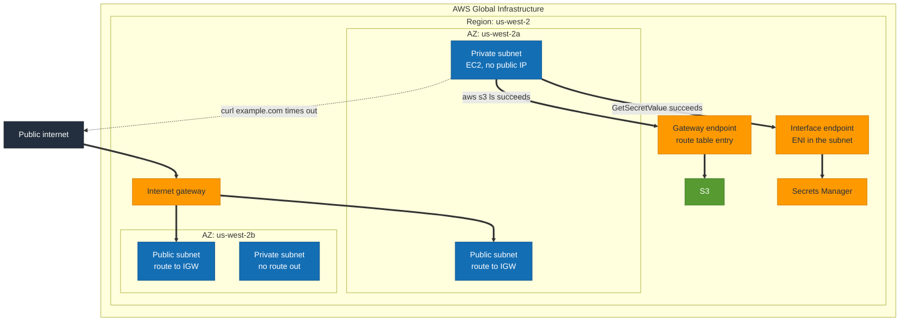

# S2 · A VPC by hand, with no NAT Gateway

**Status:** Not built yet.
**Domains:** Design Secure Architectures (30%), Design Resilient Architectures (26%)

## What it proves

Private does not have to mean NAT. And the stateful against stateless split
between security groups and network ACLs, which trips up more candidates than
any other single fact on the exam.

## What gets built

- Two availability zones, public and private subnets in each
- Internet gateway, explicit route tables per subnet tier
- Security groups and network ACLs
- Gateway VPC endpoint for S3
- Interface VPC endpoint for Secrets Manager
- An instance in a private subnet with no route to the internet at all

## How it will fit together

> **This diagram is the plan, not a record.** Nothing here is built yet, so the
> shape is intended rather than observed. It gets corrected against reality once
> the project is built, the same way S1's was.

The private subnet has no NAT Gateway and no route to the internet. The two
endpoints are how it still reaches AWS services: the gateway endpoint is a route
table entry and costs nothing, the interface endpoint is an ENI inside the
subnet and bills by the hour. The dotted arrow is the test that proves the
isolation, and it is supposed to fail.

## The measurement

- From the private instance, `aws s3 ls` succeeds through the gateway endpoint
  while `curl https://example.com` times out
- The headline test: an NACL permitting inbound 443 but blocking outbound
  ephemeral ports kills return traffic, while the equivalent security group
  configuration works. Capture both.

That second experiment is the whole point. Stateful against stateless stops
being a definition to memorise once you have watched the packets die.

## Run

    TBD

## Results

TBD
