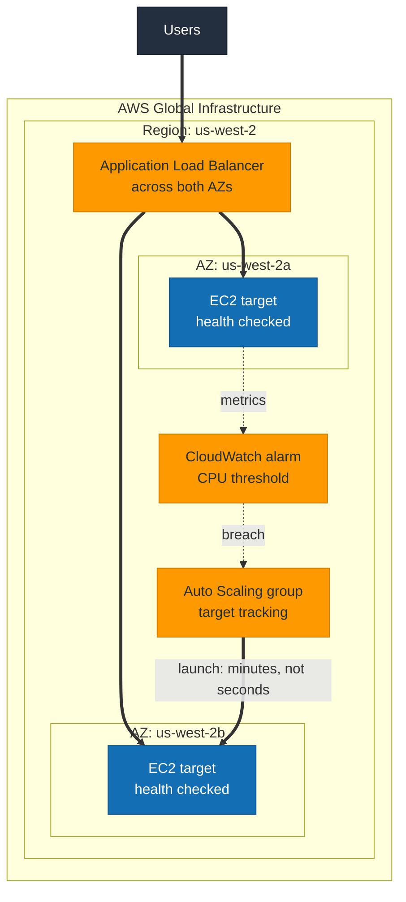

# S3 · Scale and self-healing

**Status:** Not built yet.
**Domains:** Design Resilient Architectures (26%), Design High-Performing Architectures (24%)

## What it proves

Auto Scaling is not instant. That is precisely why the exam wants you scaling
on a leading signal rather than a trailing one.

## What gets built

- Application Load Balancer across both availability zones
- Auto Scaling group with a target tracking policy
- Health checks that actually fail when the application does, not just when the
  instance stops

## How it will fit together

> **This diagram is the plan, not a record.** Nothing here is built yet, so the
> shape is intended rather than observed. It gets corrected against reality once
> the project is built, the same way S1's was.

The dotted path is the one being measured. Metrics reach CloudWatch on a
delay, the alarm needs consecutive breaching periods, and the launched instance
then has to boot and pass health checks before the load balancer sends it
anything. Each hop adds time, which is the whole reason the exam prefers a
leading signal.

## The measurement

- Terminate an instance, time the replacement reaching InService
- Load-test and time the full chain: alarm breach, scaling activity, new
  instance healthy and serving traffic
- Swap target tracking for step scaling and compare the response curves

The gap between "CPU crossed the threshold" and "new capacity is serving
requests" is minutes. Measuring it yourself changes how you answer every
scaling question on the exam.

## Run

    TBD

## Results

TBD
