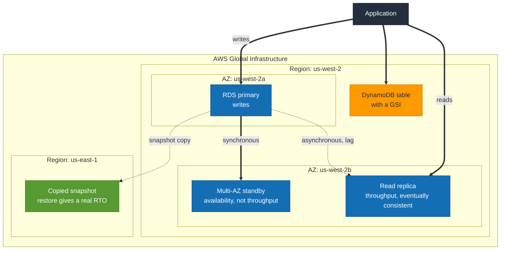

# S4 · The data tier

**Status:** Not built yet.
**Domains:** Design Resilient Architectures (26%), Design High-Performing Architectures (24%)

## What it proves

Multi-AZ is availability. Read replicas are throughput. Conflating them is a
wrong answer, and the exam asks in a way that rewards knowing the difference
cold.

## What gets built

- RDS instance with Multi-AZ enabled
- A read replica
- The same access pattern on DynamoDB with a global secondary index

## How it will fit together

> **This diagram is the plan, not a record.** Nothing here is built yet, so the
> shape is intended rather than observed. It gets corrected against reality once
> the project is built, the same way S1's was.

The two replication arrows are the exam question. Solid to the standby is
synchronous, which is why failover loses nothing and why the standby serves no
reads. Dotted to the replica is asynchronous, which is why it scales reads and
why promoting it can lose writes. Same picture, two different guarantees.

## The measurement

- Force a Multi-AZ failover, time the DNS cutover, and note that the endpoint
  does not change
- Put write load on the primary and record replica lag, proving the replica is
  eventually consistent and therefore not a failover target
- On DynamoDB, run a query that needs the GSI and one that does not, and
  compare consumed capacity
- Copy a snapshot cross-region and time a restore, which gives a real RTO
  figure rather than a guessed one

## Run

    TBD

## Results

TBD
