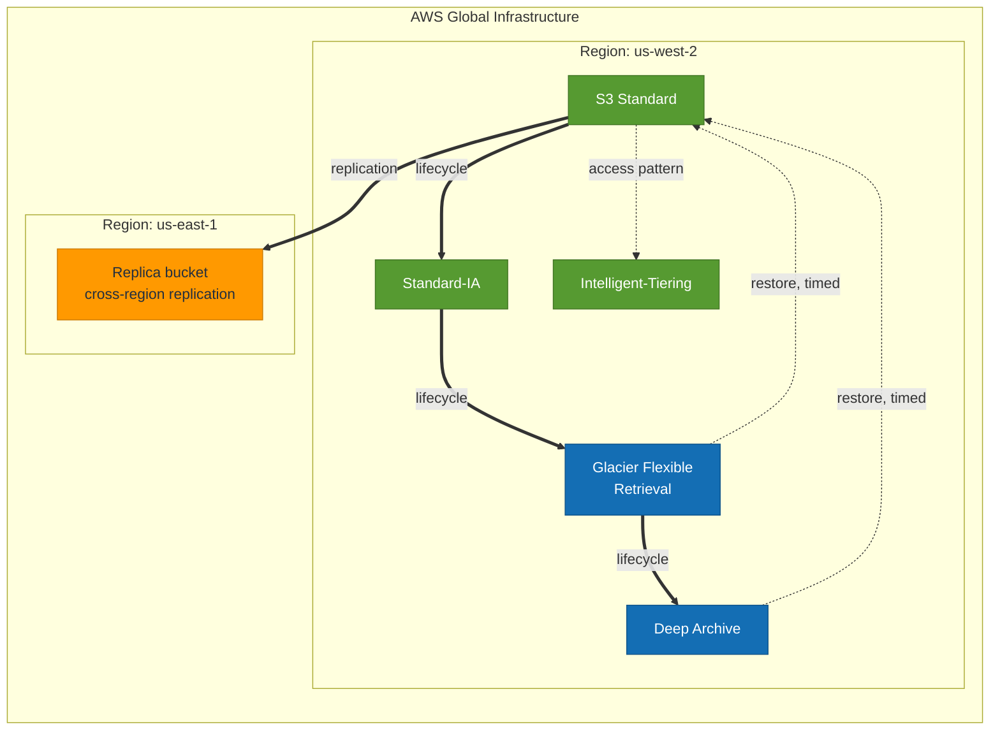

# S5 · Storage classes and lifecycle economics

**Status:** Not built yet.
**Domains:** Design Cost-Optimized Architectures (20%), Design Resilient Architectures (26%)

## What it proves

The retrieval tier you pick is a latency decision disguised as a cost decision.
And the early-delete minimums are where lab accounts quietly bleed.

Start this one early. Lifecycle transitions take days to happen, so the work is
a day spread over a week of waiting.

## What gets built

- One bucket, objects pushed through Standard, Standard-IA,
  Intelligent-Tiering, Glacier Flexible Retrieval and Deep Archive via
  lifecycle rules
- Versioning enabled
- Cross-region replication to a second bucket

## How it will fit together

> **This diagram is the plan, not a record.** Nothing here is built yet, so the
> shape is intended rather than observed. It gets corrected against reality once
> the project is built, the same way S1's was.

Transitions run left to right on a schedule you write. Restores run right to
left on a delay you do not control, and that asymmetry is the finding: moving
data down is a cost decision made in advance, getting it back is a latency
decision made under pressure. Intelligent-Tiering is drawn off the main line
because it moves objects on observed access rather than on elapsed days.

## The measurement

- Actually restore from Glacier Flexible and from Deep Archive, and time both,
  rather than quoting the documented ranges
- Pull per-GB-month rates for every class from the Pricing API and build the
  crossover table: at what access frequency does each class win
- Show what a delete does under versioning, and what a noncurrent-version
  lifecycle rule does about it

## Run

    TBD

## Results

TBD
