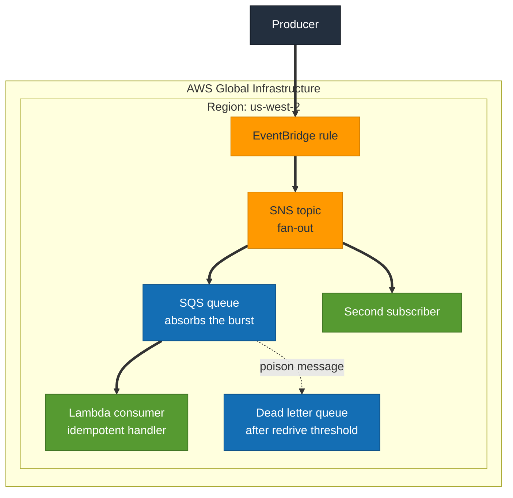

# S6 · Decoupling

**Status:** Not built yet.
**Domains:** Design Resilient Architectures (26%), Design High-Performing Architectures (24%)

## What it proves

Correctly decoupled, a downstream failure becomes a backlog rather than an
outage.

## What gets built

- SQS queue with a Lambda consumer
- SNS fan-out to a second subscriber
- Dead letter queue
- EventBridge rule as the trigger

## How it will fit together

> **This diagram is the plan, not a record.** Nothing here is built yet, so the
> shape is intended rather than observed. It gets corrected against reality once
> the project is built, the same way S1's was.

SNS fans out, SQS buffers. That split is the point: the topic delivers to
every subscriber at once and keeps nothing, the queue holds work until a
consumer is ready. Break the Lambda and the queue depth grows while the producer
carries on, which is the difference between a backlog and an outage.

## The measurement

- Burst several thousand messages and chart queue depth against consumer
  throughput, showing the queue absorbing the spike
- Deliberately break the consumer and show messages accumulating rather than
  being lost
- Send a poison message and watch it reach the DLQ after the redrive threshold
- Send the same message twice and show the handler is idempotent, because
  at-least-once delivery is the detail people skip

## Run

    TBD

## Results

TBD
