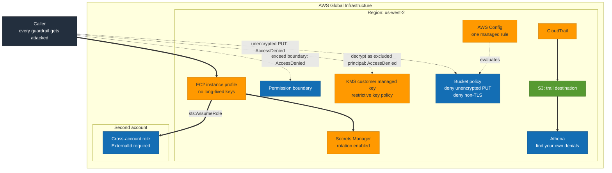

# S7 · Security and governance

**Status:** Not built yet.
**Domain:** Design Secure Architectures (30%)

The largest domain gets the largest project.

## What it proves

A guardrail you have not tested is a guess.

## What gets built

- EC2 instance profile replacing long-lived access keys
- Cross-account role assumption with an ExternalId
- A permission boundary
- KMS customer managed key with a restrictive key policy
- Bucket policy denying both unencrypted PUT and non-TLS requests
- Secrets Manager with rotation enabled
- CloudTrail delivering to S3, queried through Athena
- AWS Config with one managed rule

## How it will fit together

> **This diagram is the plan, not a record.** Nothing here is built yet, so the
> shape is intended rather than observed. It gets corrected against reality once
> the project is built, the same way S1's was.

Every dotted arrow is an attempt that is supposed to fail, and the captured
`AccessDenied` is the deliverable. The solid path is what the caller is allowed
to do. CloudTrail to S3 to Athena is the loop that closes it: a guardrail you
cannot find the denial for in the logs is a guardrail you cannot prove fired.

## The measurement

Every guardrail gets attacked.

- Attempt the unencrypted PUT, capture the AccessDenied
- Attempt to exceed the permission boundary, capture the failure
- Attempt to decrypt with a principal the key policy excludes
- Find your own denied calls in CloudTrail via Athena, which is the skill that
  actually matters during an incident

A screenshot of a policy proves nothing. The captured denial proves the policy
works.

## Run

    TBD

## Results

TBD
